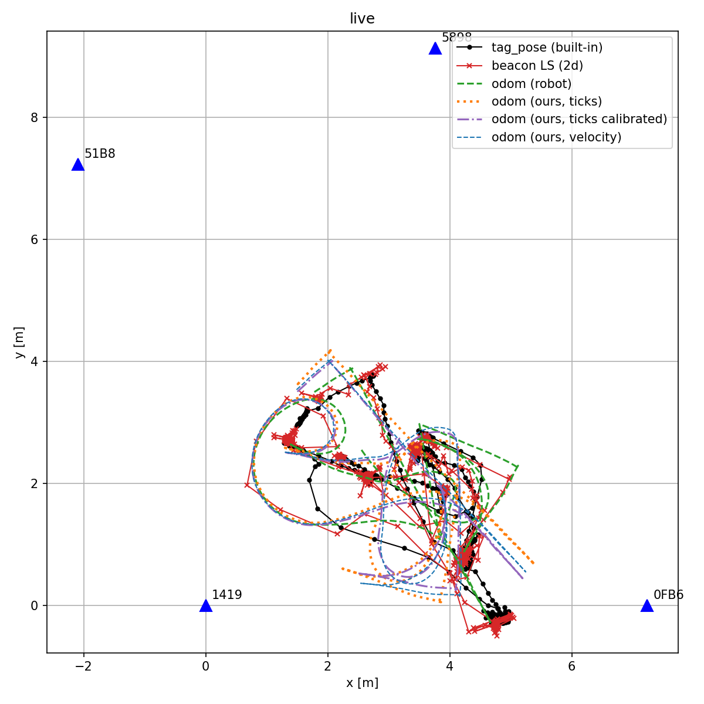
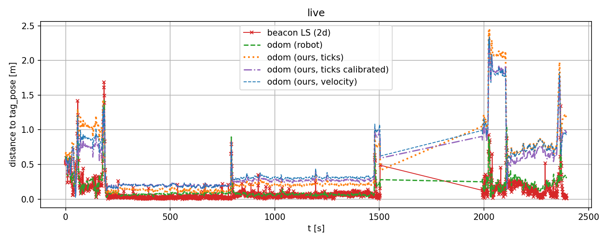

# Results

Localization config: `LocalizationConfig(mode='2d', tag_height=0.3, max_anchor_z_margin=0.05, robust_loss='linear', loss_scale=0.1, min_anchors=3, min_anchors_with_prior=2, max_residual_rms=0.5)`

## live

Distance to `tag_pose` [m] (odometry aligned to `tag_pose` by a best-fit rigid transform):

| method | samples | mean | RMSE | median | p95 | max |
|---|---|---|---|---|---|---|
| beacon LS (2d) | 1909 | 0.111 | 0.195 | 0.058 | 0.380 | 1.684 |
| odom (robot) | 1909 | 0.144 | 0.209 | 0.080 | 0.355 | 1.425 |
| odom (ours, ticks) | 1909 | 0.453 | 0.666 | 0.211 | 1.425 | 2.440 |
| odom (ours, ticks calibrated) | 1909 | 0.446 | 0.594 | 0.271 | 1.267 | 2.267 |
| odom (ours, velocity) | 1909 | 0.481 | 0.628 | 0.310 | 1.299 | 2.341 |

Static spread = RMS distance to the mean position before the robot starts moving (23.5 s). Closure = |end - start|.

| method | samples | rate [Hz] | static spread [m] | closure [m] |
|---|---|---|---|---|
| tag_pose (built-in) | 1909 | 0.8 | 0.088 | 0.918 |
| beacon LS (2d) | 1909 | 0.8 | 0.068 | 1.030 |
| odom (robot) | 19097 | 8.0 | 0.000 | 1.201 |
| odom (ours, ticks) | 19097 | 8.0 | 0.000 | 2.122 |
| odom (ours, ticks calibrated) | 19097 | 8.0 | 0.000 | 1.835 |
| odom (ours, velocity) | 19097 | 8.0 | 0.000 | 1.915 |
