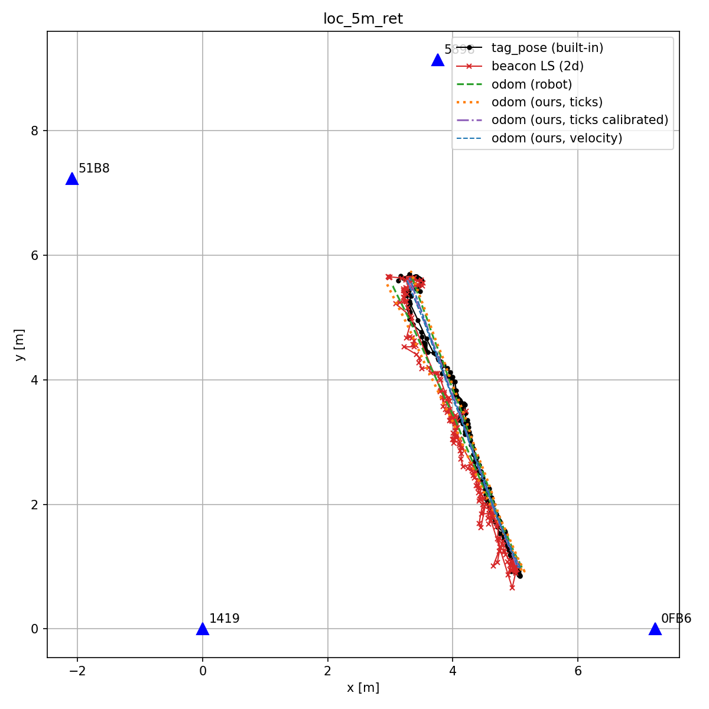
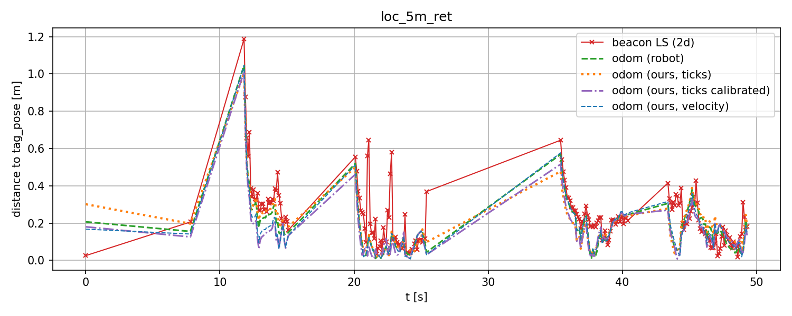
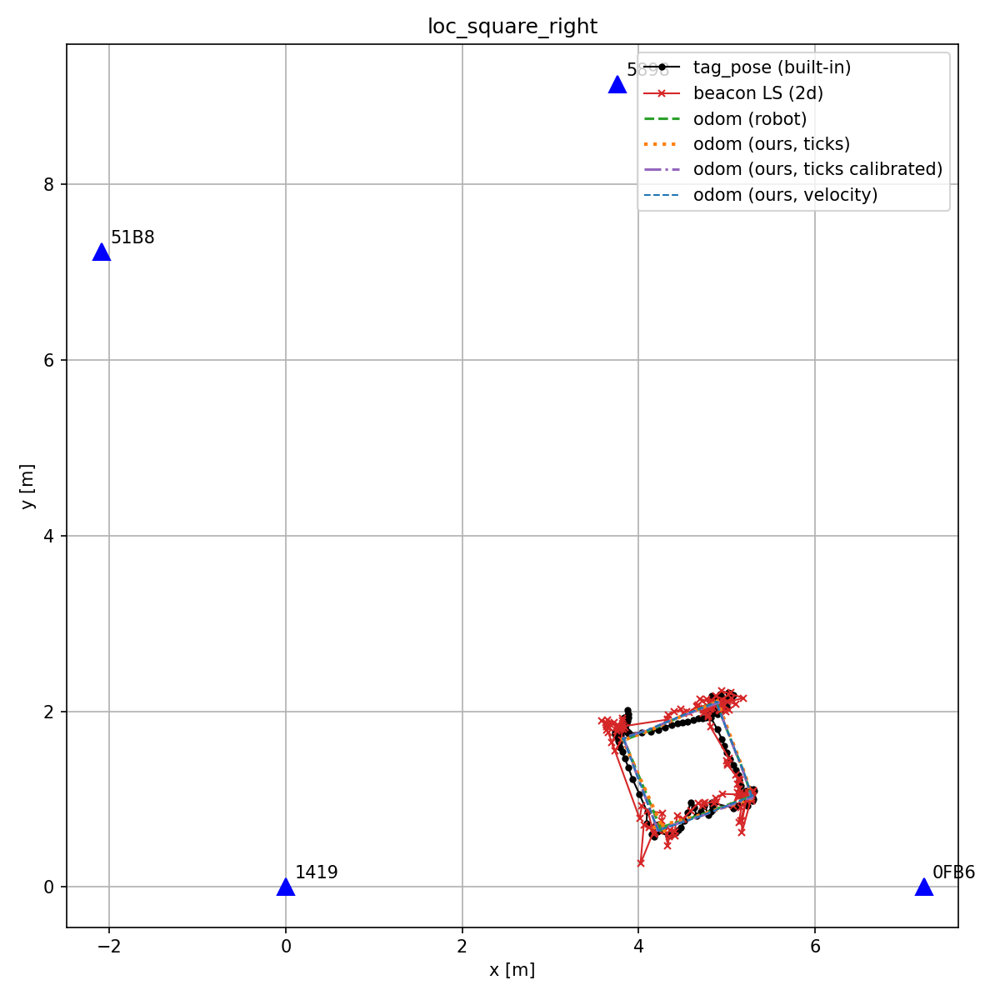

# Report – Lab 3: Beacon-based global localization

### Authors

- author1
- author2

## 1. Data

Topics (decoded from the bags, see `docs/knowledge/messages.md`):

- `/pioneerX/tag_status` (`decawave_msgs/AnchorArray`): for each visible anchor its id
  (in `header.frame_id`), position `x, y, z` and measured range `distance`.
- `/pioneerX/tag_pose` (`decawave_msgs/Tag`): built-in estimate `x, y, z`, `quality`,
  number of anchors used.

Anchors (global frame, metres): `1419` (0, 0, 1.6), `0FB6` (7.233, 0, 1.6),
`51B8` (−2.09, 7.228, 1.6), `5898` (3.76, 9.134, 1.6).

Topics are published at 10 Hz, but new range sets arrive only at 4.1 Hz
(`loc_5m_ret`), 1.2 Hz (`loc_square_left`) and 6.1 Hz (`loc_square_right`); the
rest are repeats of the previous measurement and are skipped. 3 instead of 4
anchors were seen in 11 messages.

## 2. Localization algorithm

Measurement model for anchor *i* at **a**ᵢ = (xᵢ, yᵢ, zᵢ) and tag **p** = (x, y, h):

  rᵢ = ‖**p** − **a**ᵢ‖ + εᵢ

All anchors lie in the plane z = 1.6 m, so the tag height is barely observable
(the built-in `tag_pose.z` varies between −0.07 and 1.5 m). We therefore fix the
tag height h (default 0.3 m) and estimate (x, y) only.

**Linear solution.** With the horizontal range qᵢ = rᵢ² − (h − zᵢ)²:

  (x − xᵢ)² + (y − yᵢ)² = qᵢ

Subtracting the equation for anchor 0 from the one for anchor i (i = 1…N−1):

  2(xᵢ − x₀)·x + 2(yᵢ − y₀)·y = q₀ − qᵢ + xᵢ² − x₀² + yᵢ² − y₀²

i.e. **A**[x y]ᵀ = **b**, solved by least squares: [x y]ᵀ = (**A**ᵀ**A**)⁻¹**A**ᵀ**b**.
Three anchors give an exact solution, four an overdetermined one.

**Nonlinear refinement.** Starting from the linear solution we minimise the
range residuals

  min₍ₓ,ᵧ₎ Σᵢ ( √((x − xᵢ)² + (y − yᵢ)² + (h − zᵢ)²) − rᵢ )²

with `scipy.optimize.least_squares` (trust-region). This weights all ranges
equally, unlike the linear form, which works on squared ranges.

**Special cases.** Fewer than 3 anchors: with 2 anchors the refinement starts from
the previous fix; with fewer no fix is produced. Fixes with residual RMS > 0.5 m
are rejected. An optional 3D mode estimates z too, bounded to z < 1.55 m (tag
below the anchors) to resolve the mirror ambiguity.

**Own odometry (from lab 2).** Differential drive, midpoint integration:
Δs = (Δs_R + Δs_L)/2, Δθ = (Δs_R − Δs_L)/b (b = 0.325 m),
x += Δs cos(θ + Δθ/2), y += Δs sin(θ + Δθ/2), θ += Δθ.
The wheel displacements Δs_L, Δs_R are computed in three ways:

- *ticks*: from the 16-bit encoder counters, Δs = r · Δticks · 2π / (4·500·38.3),
  with the measured r = 0.0975 m;
- *ticks calibrated*: the same with the effective rolling radius found in lab 2
  (ticks overestimated distance by 2.4 %, r_eff = 0.0975 / 1.0245 ≈ 0.0952 m);
- *velocity*: from the linear wheel speeds in `joint_states.velocity` (mm/s),
  Δs = v · Δt; no radius is needed.

## 3. Evaluation method

- Reference: `tag_pose` (no ground truth available), repeated samples removed.
- Time matching: each method is interpolated at the `tag_pose` timestamps (max gap 0.3 s).
- Odometry frames (robot `odom` and ours) are mapped to the global frame with the
  best-fit rigid 2D transform (Kabsch/SVD) over the whole run.
- Metrics: horizontal distance to the reference (mean, RMSE, median, 95th
  percentile, max), static spread before motion (precision), and closure |end − start|.

## 4. Results

Full tables and figures for each bag: [results/results.md](results/results.md).
3D-mode results: [results_3d/results.md](results_3d/results.md).

RMSE to `tag_pose` [m]:

| Bag | our beacon LS (2D) | robot `odom` | ours: ticks | ours: ticks calibrated | ours: velocity |
|---|---|---|---|---|---|
| `loc_5m_ret` | 0.278 | 0.217 | 0.216 | 0.188 | 0.206 |
| `loc_square_left` | 0.315 | 0.242 | 0.226 | 0.229 | 0.240 |
| `loc_square_right` | 0.200 | 0.154 | 0.149 | 0.142 | 0.153 |

Closure |end − start| [m] (5m_ret / square_left / square_right):
robot `odom` 0.340 / 0.032 / 0.052; ticks 0.432 / 0.200 / 0.121;
ticks calibrated 0.054 / 0.077 / 0.005; velocity 0.068 / 0.074 / 0.017.

Sensitivity of our algorithm (RMSE [m], 5m_ret / square_left / square_right):
h = 0.0 m: 0.293 / 0.316 / 0.202; h = 0.3 m: 0.278 / 0.315 / 0.200;
h = 0.6 m: 0.269 / 0.314 / 0.202; 3D: 0.266 / 0.316 / 0.221;
soft-L1 loss: 0.292 / 0.301 / 0.208.

## 5. Discussion

<!-- TODO: check and rewrite in your own words -->

- Our trilateration follows the same path as the built-in estimate; the typical
  difference is 0.1–0.2 m (median 0.11–0.21 m), comparable to the range residuals
  (0.07–0.15 m RMS).
- Our fixes are noisier than `tag_pose`; the built-in algorithm appears to filter
  over time. During motion it seems to lag: the error spikes of all three methods
  (which are independent of each other) occur at the same moments, so they most
  likely come from the reference itself.
- Odometry has the lowest error here only because it was aligned to the reference
  with the best possible rigid transform over the whole run; this hides most of
  its drift. Beacon localization needs no alignment and its error does not grow
  with distance travelled.
- The radius calibration from lab 2 carries over to this robot: with it the
  tick odometry closes the loops to 0.5–8 cm instead of 12–43 cm, and the
  velocity version (which uses the robot's own calibration) behaves the same.
  Against `tag_pose`, all odometry variants differ by only a few cm, because
  the rigid alignment absorbs most of the scale error.
- The low and irregular measurement rate (1.2 Hz in `loc_square_left`, with a gap
  covering a whole side of the square) is the main weakness of the UWB system;
  odometry is available at 10 Hz. Combining both (e.g. a Kalman filter) would
  give a smooth and drift-free estimate.
- The tag height has little influence (a few cm) because the anchors are far
  away compared with the height difference.

## 6. Conclusions

<!-- TODO -->
