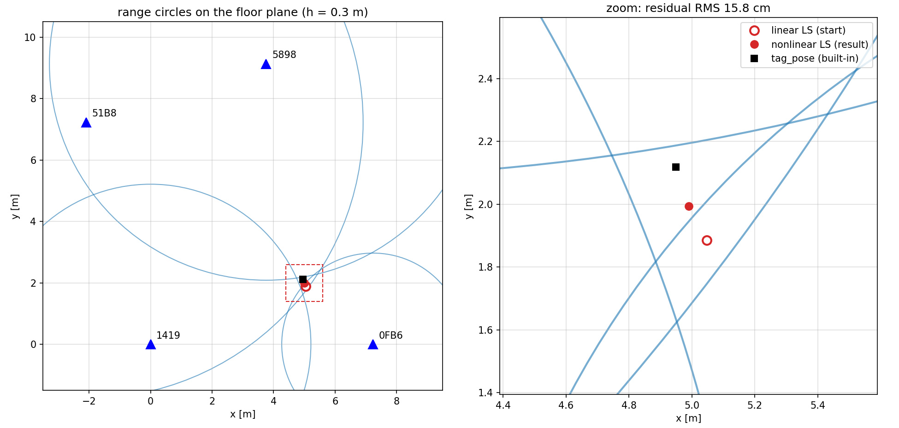
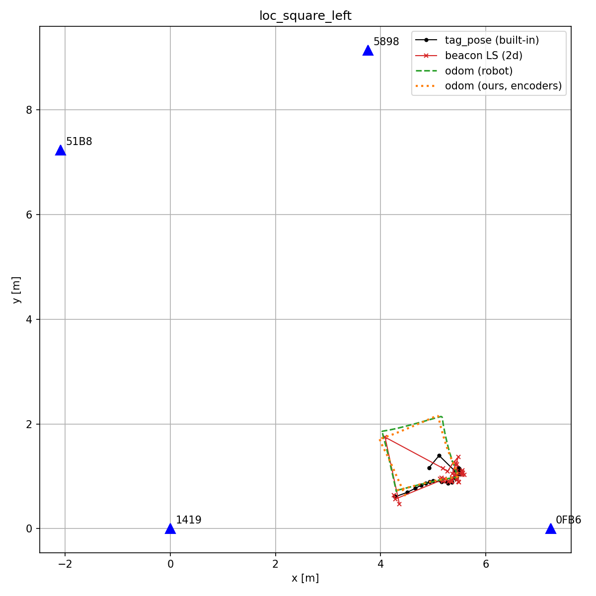

# Report – Lab 3: Beacon-based global localization

### Authors

- Patryk Dudziński
- Jakub Staudt

## 1. Localization algorithm

Measurement model for anchor *i* at **a**ᵢ = (xᵢ, yᵢ, zᵢ) and tag **p** = (x, y, h):

  rᵢ = ‖**p** − **a**ᵢ‖ + εᵢ

All anchors lie in the plane z = 1.6 m, so the tag height is barely observable
(the built-in `tag_pose.z` varies between −0.07 and 1.5 m). We therefore fix the
tag height h (default 0.3 m) and estimate (x, y) only.

**Linear solution.** With the horizontal range qᵢ = rᵢ² − (h − zᵢ)²:

  (x − xᵢ)² + (y − yᵢ)² = qᵢ

Subtracting the equation for anchor 0 from the one for anchor i (i = 1…N−1):

  2(xᵢ − x₀)·x + 2(yᵢ − y₀)·y = q₀ − qᵢ + xᵢ² − x₀² + yᵢ² − y₀²

i.e. **A**[x y]ᵀ = **b**, solved by least squares: [x y]ᵀ = (**A**ᵀ**A**)⁻¹**A**ᵀ**b**.
Three anchors give an exact solution, four an overdetermined one.

**Nonlinear refinement.** Starting from the linear solution we minimise the
range residuals

  min₍ₓ,ᵧ₎ Σᵢ ( √((x − xᵢ)² + (y − yᵢ)² + (h − zᵢ)²) − rᵢ )²

with `scipy.optimize.least_squares` (trust-region). This weights all ranges
equally, unlike the linear form, which works on squared ranges.

*One message from `loc_square_right` (t = 13.4 s): each range becomes a circle
on the floor plane; the linear solution (hollow) is moved 12 cm by the nonlinear
step (filled) to the point that fits all four circles best (residual RMS 15.8 cm).
Generated by `python3 -m beacon_localization.example_figure`.*

**Special cases.** Fewer than 3 anchors: with 2 anchors the refinement starts from
the previous fix; with fewer no fix is produced. Fixes with residual RMS > 0.5 m
are rejected.

**Own odometry (from lab 2).** Differential drive, midpoint integration:
The wheel displacements Δs_L, Δs_R are computed in three ways:

- *ticks*: from the 16-bit encoder counters, Δs = r · Δticks · 2π / (4·500·38.3),
  with the measured r = 0.0975 m;
- *ticks calibrated*: the same with the effective rolling radius found in lab 2
  (ticks overestimated distance by 2.4 %, r_eff = 0.0975 / 1.0245 ≈ 0.0952 m);
- *velocity*: from the linear wheel speeds in `joint_states.velocity` (mm/s),
  Δs = v · Δt; no radius is needed.

## 2. Evaluation method

There is no ground truth, so two references are used:

1. **`tag_pose`** (the system's built-in estimate), as the task asks. Repeated
   samples are removed; each method is interpolated at the `tag_pose` timestamps
   (max gap 0.3 s). Odometry frames (robot `odom` and ours) are mapped to the
   global frame with the best-fit rigid 2D transform (Kabsch/SVD) over the run.
2. **Our calibrated wheel odometry**, as an independent cross-check of the two
   UWB methods. It does not use UWB, has no gaps and drifts only a few cm on
   these short runs (closure 0.5–8 cm). Each UWB trajectory is rigid-aligned to
   it, and the odometry is also shifted in time to find the lag that fits best.

Metrics: horizontal distance (mean, RMSE, median, 95th percentile, max), static
spread before motion (precision), closure |end − start| and time lag.

## 3. Results and conclusions

RMSE against `tag_pose` [m] (odometry rigid-aligned to `tag_pose`):

| Bag | our beacon LS | robot `odom` | ours: ticks | ours: ticks calibrated | ours: velocity |
|---|---|---|---|---|---|
| `loc_5m_ret` | 0.278 | 0.217 | 0.216 | 0.188 | 0.206 |
| `loc_square_left` | 0.315 | 0.242 | 0.226 | 0.229 | 0.240 |
| `loc_square_right` | 0.200 | 0.154 | 0.149 | 0.142 | 0.153 |

Cross-check against our calibrated wheel odometry (independent of UWB):

| Bag | max error `tag_pose` | max error our beacon LS | `tag_pose` lag behind our beacon LS |
|---|---|---|---|
| `loc_5m_ret` | 1.01 m | 0.49 m | 0.45 s |
| `loc_square_left` | 0.81 m | 0.29 m | 0.90 s |
| `loc_square_right` | 0.58 m | 0.43 m | 0.35 s |

## 4. Conclusions

1. **Our algorithm works.** It stays within 0.15–0.3 m (RMSE) of the built-in
   estimate and needs only 3 anchors (2 with the previous fix).
2. **Our algorithm handles motion better than `tag_pose`.** `tag_pose` is smoothed and lags
   0.35–0.9 s behind our result, which causes its errors of up to 1 m. 17 of
   the 19 differences above 0.5 m come right after a measurement gap.
3. **UWB has gaps.** For 1–10 s at a time no new ranges arrive while the
   robot drives up to 1.85 m, so any UWB-only position freezes.
4. **Odometry is smooth but drifts.** The lab 2 radius calibration works here
   too: loops close to 0.5–8 cm instead of 12–43 cm. Its low error against
   `tag_pose` comes from aligning it over the whole run.
5. **The tag height cannot be measured.** All anchors are at 1.6 m, so z is
   ambiguous. Fixing it costs little: h from 0 to 0.6 m changes the RMSE by
   1–2 cm.
6. **Next step:** fuse odometry with the beacon fixes (e.g. a Kalman filter)
   to bridge the gaps without drift.
