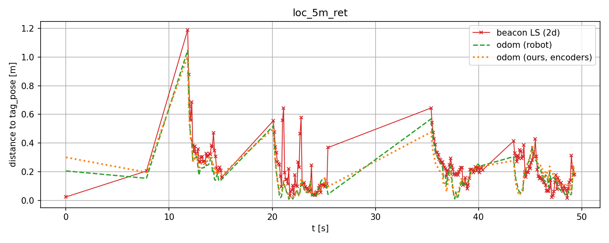
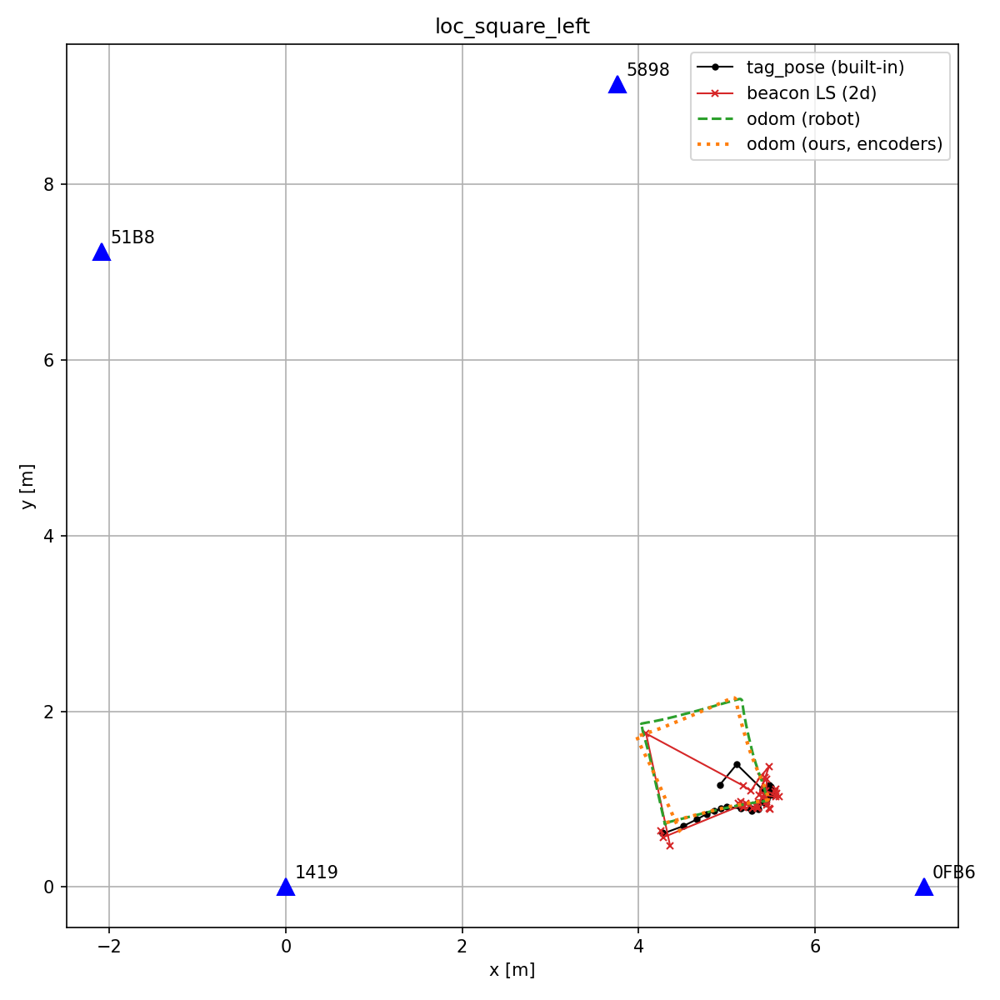
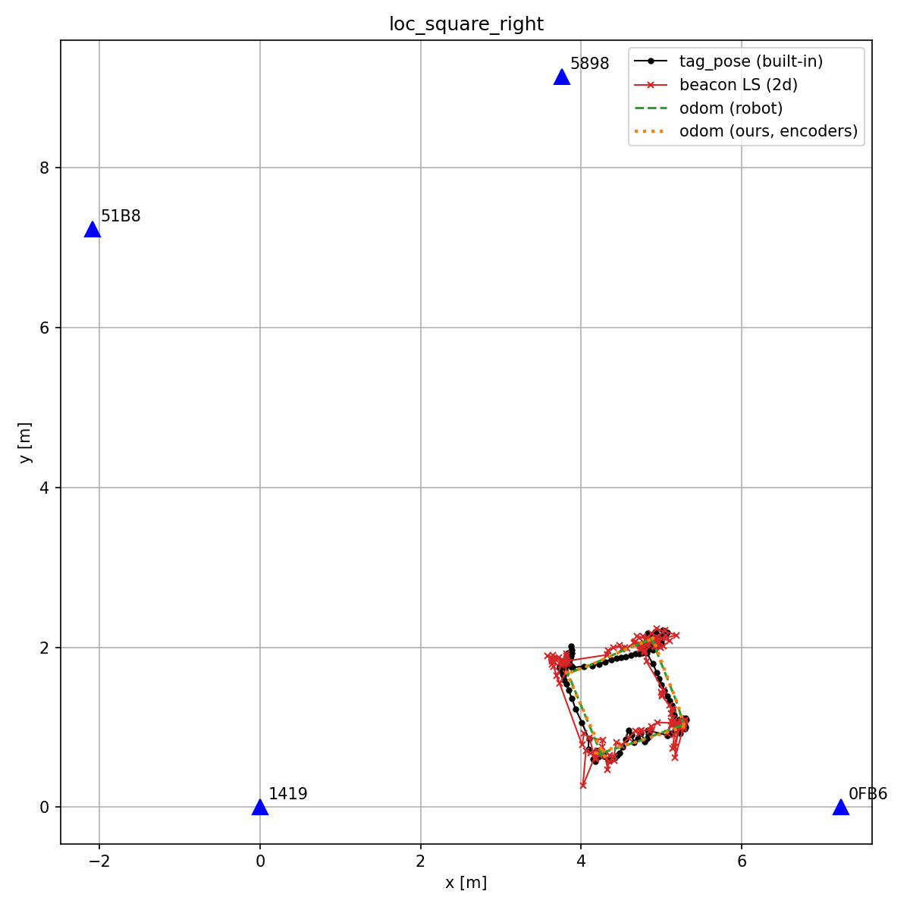

# Results

Localization config: `LocalizationConfig(mode='2d', tag_height=0.3, max_anchor_z_margin=0.05, robust_loss='linear', loss_scale=0.1, min_anchors=3, min_anchors_with_prior=2, max_residual_rms=0.5)`

## loc_5m_ret

Distance to `tag_pose` [m] (odometry aligned to `tag_pose` by a best-fit rigid transform):

| method | samples | mean | RMSE | median | p95 | max |
|---|---|---|---|---|---|---|
| beacon LS (2d) | 201 | 0.230 | 0.278 | 0.210 | 0.541 | 1.188 |
| odom (robot) | 201 | 0.173 | 0.217 | 0.150 | 0.386 | 1.046 |
| odom (ours, ticks) | 201 | 0.179 | 0.216 | 0.167 | 0.344 | 1.005 |
| odom (ours, ticks calibrated) | 201 | 0.147 | 0.188 | 0.126 | 0.328 | 1.012 |
| odom (ours, velocity) | 201 | 0.161 | 0.206 | 0.142 | 0.371 | 1.046 |

Static spread = RMS distance to the mean position before the robot starts moving (5.6 s). Closure = |end - start|.

| method | samples | rate [Hz] | static spread [m] | closure [m] |
|---|---|---|---|---|
| tag_pose (built-in) | 201 | 4.1 | n/a | 0.251 |
| beacon LS (2d) | 201 | 4.1 | n/a | 0.309 |
| odom (robot) | 573 | 10.0 | 0.000 | 0.340 |
| odom (ours, ticks) | 573 | 10.0 | 0.000 | 0.432 |
| odom (ours, ticks calibrated) | 573 | 10.0 | 0.000 | 0.054 |
| odom (ours, velocity) | 573 | 10.0 | 0.000 | 0.068 |

Cross-check against `odom (ours, ticks calibrated)` (rigid-aligned to each method; lag > 0 means the method is behind the odometry) [m]:

| method | samples | RMSE | p95 | max | best lag [s] | RMSE at best lag |
|---|---|---|---|---|---|---|
| tag_pose (built-in) | 200 | 0.188 | 0.328 | 1.012 | +0.20 | 0.171 |
| beacon LS (2d) | 200 | 0.165 | 0.300 | 0.488 | -0.25 | 0.138 |

Gaps without a new range measurement (> 0.5 s):

| start [s] | duration [s] | robot drove [m] |
|---|---|---|
| -0.0 | 7.8 | 0.27 |
| 7.8 | 4.0 | 1.38 |
| 15.1 | 5.0 | 0.68 |
| 25.4 | 10.0 | 0.84 |
| 40.4 | 3.0 | 0.64 |

## loc_square_left

Distance to `tag_pose` [m] (odometry aligned to `tag_pose` by a best-fit rigid transform):

| method | samples | mean | RMSE | median | p95 | max |
|---|---|---|---|---|---|---|
| beacon LS (2d) | 35 | 0.200 | 0.315 | 0.113 | 0.768 | 1.086 |
| odom (robot) | 35 | 0.158 | 0.242 | 0.105 | 0.548 | 0.853 |
| odom (ours, ticks) | 35 | 0.146 | 0.226 | 0.096 | 0.501 | 0.830 |
| odom (ours, ticks calibrated) | 35 | 0.148 | 0.229 | 0.099 | 0.515 | 0.818 |
| odom (ours, velocity) | 35 | 0.158 | 0.240 | 0.108 | 0.544 | 0.842 |

Static spread = RMS distance to the mean position before the robot starts moving (4.3 s). Closure = |end - start|.

| method | samples | rate [Hz] | static spread [m] | closure [m] |
|---|---|---|---|---|
| tag_pose (built-in) | 35 | 1.2 | 0.005 | 0.852 |
| beacon LS (2d) | 35 | 1.2 | 0.038 | 0.196 |
| odom (robot) | 350 | 10.0 | 0.000 | 0.032 |
| odom (ours, ticks) | 350 | 10.0 | 0.000 | 0.200 |
| odom (ours, ticks calibrated) | 350 | 10.0 | 0.000 | 0.077 |
| odom (ours, velocity) | 350 | 10.0 | 0.000 | 0.074 |

Cross-check against `odom (ours, ticks calibrated)` (rigid-aligned to each method; lag > 0 means the method is behind the odometry) [m]:

| method | samples | RMSE | p95 | max | best lag [s] | RMSE at best lag |
|---|---|---|---|---|---|---|
| tag_pose (built-in) | 34 | 0.230 | 0.529 | 0.813 | +0.50 | 0.200 |
| beacon LS (2d) | 34 | 0.149 | 0.265 | 0.290 | -0.40 | 0.133 |

Gaps without a new range measurement (> 0.5 s):

| start [s] | duration [s] | robot drove [m] |
|---|---|---|
| -0.0 | 1.4 | 0.00 |
| 1.4 | 5.0 | 0.53 |
| 9.4 | 10.0 | 1.85 |
| 19.4 | 10.0 | 1.71 |

## loc_square_right

Distance to `tag_pose` [m] (odometry aligned to `tag_pose` by a best-fit rigid transform):

| method | samples | mean | RMSE | median | p95 | max |
|---|---|---|---|---|---|---|
| beacon LS (2d) | 144 | 0.159 | 0.200 | 0.122 | 0.375 | 0.779 |
| odom (robot) | 144 | 0.131 | 0.154 | 0.114 | 0.275 | 0.584 |
| odom (ours, ticks) | 144 | 0.127 | 0.149 | 0.112 | 0.274 | 0.556 |
| odom (ours, ticks calibrated) | 144 | 0.120 | 0.142 | 0.105 | 0.248 | 0.580 |
| odom (ours, velocity) | 144 | 0.130 | 0.153 | 0.111 | 0.267 | 0.607 |

Static spread = RMS distance to the mean position before the robot starts moving (2.9 s). Closure = |end - start|.

| method | samples | rate [Hz] | static spread [m] | closure [m] |
|---|---|---|---|---|
| tag_pose (built-in) | 144 | 6.1 | 0.063 | 0.137 |
| beacon LS (2d) | 145 | 6.1 | 0.072 | 0.220 |
| odom (robot) | 314 | 10.0 | 0.000 | 0.052 |
| odom (ours, ticks) | 314 | 10.0 | 0.000 | 0.121 |
| odom (ours, ticks calibrated) | 314 | 10.0 | 0.000 | 0.005 |
| odom (ours, velocity) | 314 | 10.0 | 0.000 | 0.017 |

Cross-check against `odom (ours, ticks calibrated)` (rigid-aligned to each method; lag > 0 means the method is behind the odometry) [m]:

| method | samples | RMSE | p95 | max | best lag [s] | RMSE at best lag |
|---|---|---|---|---|---|---|
| tag_pose (built-in) | 143 | 0.142 | 0.250 | 0.578 | +0.25 | 0.128 |
| beacon LS (2d) | 144 | 0.134 | 0.237 | 0.428 | -0.10 | 0.131 |

Gaps without a new range measurement (> 0.5 s):

| start [s] | duration [s] | robot drove [m] |
|---|---|---|
| 0.0 | 1.8 | 0.00 |
| 1.8 | 4.0 | 1.04 |
| 8.8 | 2.0 | 0.54 |
| 15.2 | 1.0 | 0.40 |
| 19.7 | 1.0 | 0.23 |
