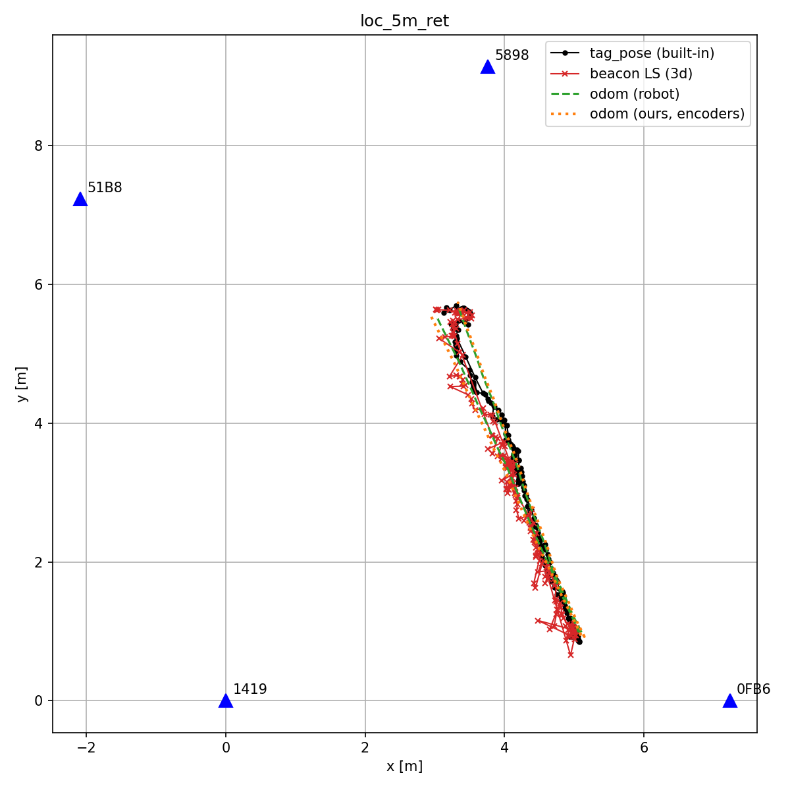
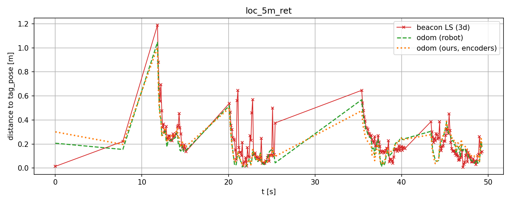
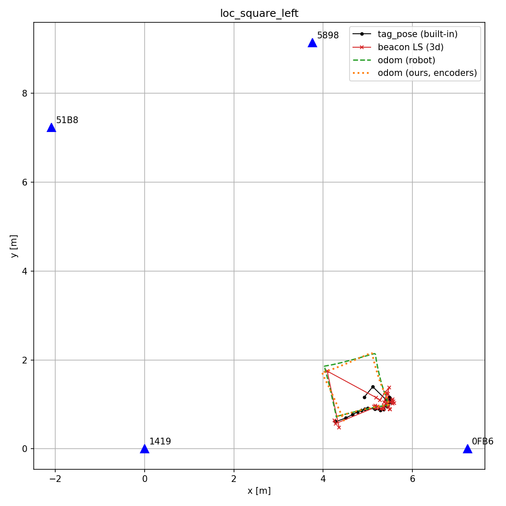
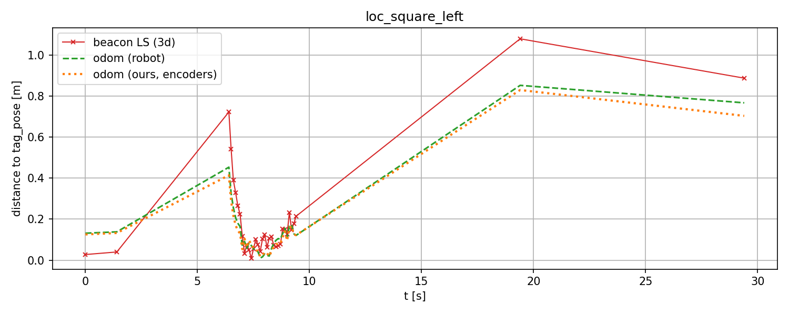
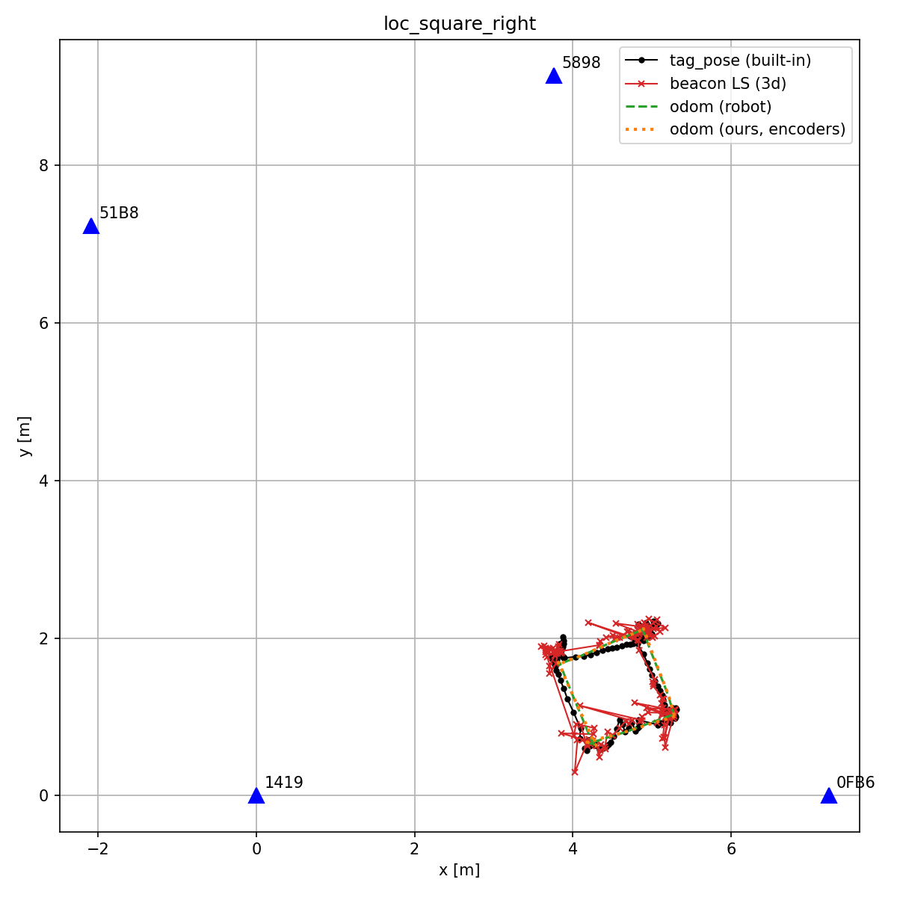
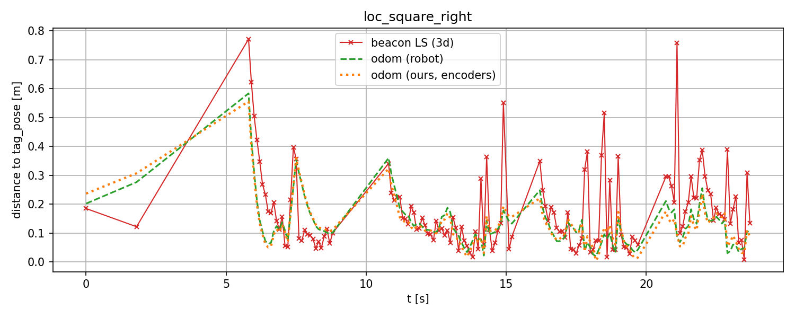

# Results

Localization config: `LocalizationConfig(mode='3d', tag_height=0.3, max_anchor_z_margin=0.05, robust_loss='linear', loss_scale=0.1, min_anchors=3, min_anchors_with_prior=2, max_residual_rms=0.5)`

## loc_5m_ret

Distance to `tag_pose` [m] (odometry aligned to `tag_pose` by a best-fit rigid transform):

| method | samples | mean | RMSE | median | p95 | max |
|---|---|---|---|---|---|---|
| beacon LS (3d) | 201 | 0.212 | 0.266 | 0.172 | 0.538 | 1.189 |
| odom (robot) | 201 | 0.173 | 0.217 | 0.150 | 0.386 | 1.046 |
| odom (ours, encoders) | 201 | 0.179 | 0.216 | 0.167 | 0.344 | 1.005 |

Static spread = RMS distance to the mean position before the robot starts moving (5.6 s). Closure = |end - start|.

| method | samples | rate [Hz] | static spread [m] | closure [m] |
|---|---|---|---|---|
| tag_pose (built-in) | 201 | 4.1 | n/a | 0.251 |
| beacon LS (3d) | 201 | 4.1 | n/a | 0.294 |
| odom (robot) | 573 | 10.0 | 0.000 | 0.340 |
| odom (ours, encoders) | 573 | 10.0 | 0.000 | 0.432 |

## loc_square_left

Distance to `tag_pose` [m] (odometry aligned to `tag_pose` by a best-fit rigid transform):

| method | samples | mean | RMSE | median | p95 | max |
|---|---|---|---|---|---|---|
| beacon LS (3d) | 35 | 0.202 | 0.316 | 0.115 | 0.772 | 1.080 |
| odom (robot) | 35 | 0.158 | 0.242 | 0.105 | 0.548 | 0.853 |
| odom (ours, encoders) | 35 | 0.146 | 0.226 | 0.096 | 0.501 | 0.830 |

Static spread = RMS distance to the mean position before the robot starts moving (4.3 s). Closure = |end - start|.

| method | samples | rate [Hz] | static spread [m] | closure [m] |
|---|---|---|---|---|
| tag_pose (built-in) | 35 | 1.2 | 0.005 | 0.852 |
| beacon LS (3d) | 35 | 1.2 | 0.037 | 0.192 |
| odom (robot) | 350 | 10.0 | 0.000 | 0.032 |
| odom (ours, encoders) | 350 | 10.0 | 0.000 | 0.200 |

## loc_square_right

Distance to `tag_pose` [m] (odometry aligned to `tag_pose` by a best-fit rigid transform):

| method | samples | mean | RMSE | median | p95 | max |
|---|---|---|---|---|---|---|
| beacon LS (3d) | 144 | 0.172 | 0.221 | 0.129 | 0.396 | 0.772 |
| odom (robot) | 144 | 0.131 | 0.154 | 0.114 | 0.275 | 0.584 |
| odom (ours, encoders) | 144 | 0.127 | 0.149 | 0.112 | 0.274 | 0.556 |

Static spread = RMS distance to the mean position before the robot starts moving (2.9 s). Closure = |end - start|.

| method | samples | rate [Hz] | static spread [m] | closure [m] |
|---|---|---|---|---|
| tag_pose (built-in) | 144 | 6.1 | 0.063 | 0.137 |
| beacon LS (3d) | 145 | 6.1 | 0.073 | 0.199 |
| odom (robot) | 314 | 10.0 | 0.000 | 0.052 |
| odom (ours, encoders) | 314 | 10.0 | 0.000 | 0.121 |
